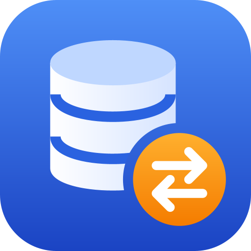
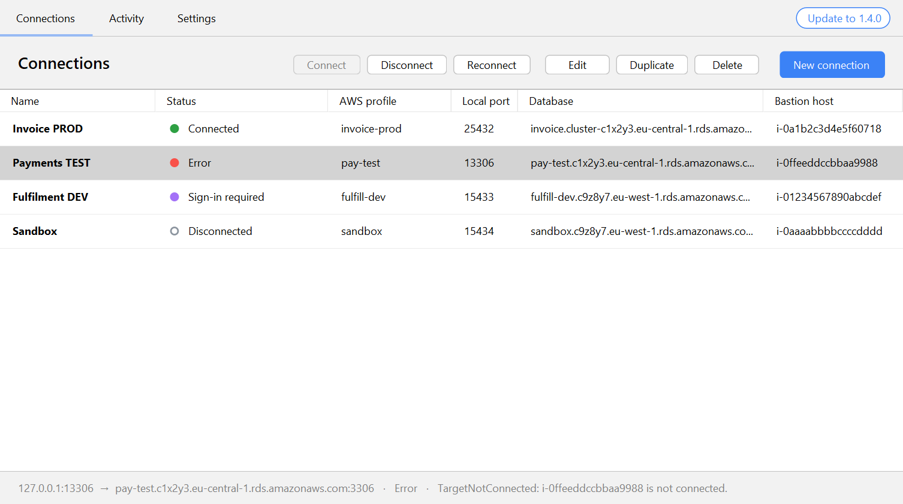
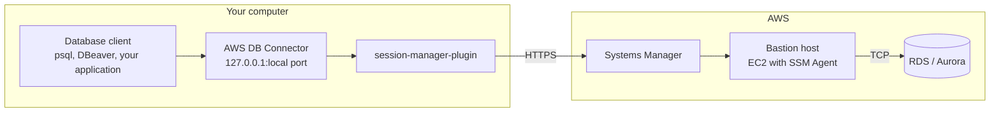

<div align="center">



# AWS DB Connector

**Reach private RDS databases from your desktop, through AWS Systems Manager.**<br>
No SSH keys, no VPN, no open inbound ports. Point your database client at `127.0.0.1` and work.

[](https://github.com/angel-milanov/AWS-DB-Connector/actions/workflows/build.yml)
[](https://github.com/angel-milanov/AWS-DB-Connector/actions/workflows/build.yml)
[](https://github.com/angel-milanov/AWS-DB-Connector/releases/latest)
[](LICENSE)


<picture>
  <source media="(prefers-color-scheme: dark)" srcset="docs/images/connections-dark.png">
  
</picture>

</div>

## What it does

AWS DB Connector is a small tray application that keeps
[Session Manager port forwarding](https://docs.aws.amazon.com/systems-manager/latest/userguide/session-manager-working-with-sessions-start.html#sessions-remote-port-forwarding)
tunnels to your databases open. It replaces the terminal tab you keep around for

```sh
aws ssm start-session --target i-0123456789abcdef0 \
  --document-name AWS-StartPortForwardingSessionToRemoteHost \
  --parameters host=mydb.xxxxxxxx.eu-central-1.rds.amazonaws.com,portNumber=5432,localPortNumber=5432
```

and takes care of what that command leaves to you: the session that times out, the SSO login that expires overnight,
and the question of which port belonged to which database.

## Features

- **A fixed local port per database.** The application owns the port for as long as a connection is active, so your
  database client keeps the same address while sessions come and go behind it.
- **Reconnects on its own.** A dropped session is re-created immediately, with retries at a growing delay (2 s up to
  60 s) while that fails, or only when a client next connects. You choose per connection.
- **AWS SSO sign-in built in.** When the SSO session has expired, the application runs `aws sso login` for the right
  profile, opens the browser and resumes every connection that was waiting for it.
- **Pick instead of type.** *Load from AWS* lists the running EC2 instances and the RDS instances and clusters
  (writer and reader endpoints) of the account, and fills in host name and port.
- **Lives in the system tray.** The icon shows the overall state at a glance; its menu connects, disconnects and
  copies the local address of every connection.
- **Health checks.** The Session Manager plugin process is watched continuously, and the session is looked up on the AWS
  side every 30 seconds (configurable).
- **Updates itself.** A new release is announced once and installed when you say so, after its SHA-256 checksum has
  been verified.
- **Stores no secrets.** Only profile names, host names, instance ids and ports are saved. Database users and
  passwords stay in your database client; AWS credentials stay with the AWS CLI.
- Light and dark theme, desktop notifications, and native packages for Windows, macOS and Linux.

## How it works



The application starts the session with the AWS SDK (`ssm:StartSession` with the document
`AWS-StartPortForwardingSessionToRemoteHost`) and hands the data channel to the AWS Session Manager plugin. The plugin
listens on a private, random loopback port; the application listens on the port you configured and forwards every TCP
connection to it. That extra hop is what lets a session be replaced without your client noticing more than a reconnect.

Tunnels are only reachable from your own computer: they are bound to the loopback interface.

## Requirements

**On your computer**

| | Needed for |
| --- | --- |
| [AWS Session Manager plugin](https://docs.aws.amazon.com/systems-manager/latest/userguide/session-manager-working-with-install-plugin.html) | Opening tunnels (required) |
| [AWS CLI v2](https://docs.aws.amazon.com/cli/latest/userguide/getting-started-install.html) | The SSO sign-in (`aws sso login`) |
| An AWS profile in `~/.aws/config` | Credentials. Any profile the AWS SDK can resolve works; the automatic sign-in needs an IAM Identity Center (SSO) profile, also when it is used through `source_profile`. |

Both tools are found on the `PATH` and in their default install locations. Other locations can be set under
*Settings > Tools*. Java is not needed: the packages bring their own runtime.

**In your AWS account**

- A bastion host: an EC2 instance that is
  [managed by Systems Manager](https://docs.aws.amazon.com/systems-manager/latest/userguide/session-manager-getting-started.html)
  (SSM Agent 3.1.1374.0 or later, an instance profile such as `AmazonSSMManagedInstanceCore`) and is allowed to reach
  the database by the database's security group. It needs no public IP address and no inbound rules.
- These permissions for the profile you connect with:

| Permission | Used for | |
| --- | --- | --- |
| `ssm:StartSession` on the bastion host and on the document `AWS-StartPortForwardingSessionToRemoteHost` | Opening the tunnel | required |
| `ssm:TerminateSession` | Closing the session on the AWS side when you disconnect | recommended |
| `ssm:DescribeSessions` | The periodic check that the session still exists | optional |
| `ec2:DescribeInstances`, `rds:DescribeDBInstances`, `rds:DescribeDBClusters` | *Load from AWS* in the connection dialog | optional |

Despite the name, the target does not have to be RDS: the host name is free text, so anything the bastion host can
reach over TCP works.

## Installation

Download the package for your platform from the
[latest release](https://github.com/angel-milanov/AWS-DB-Connector/releases/latest):

| Platform | File | |
| --- | --- | --- |
| Windows (x64) | `*-windows-x64.msi` or `*-windows-x64.exe` | Installer |
| | `*-windows-x64.zip` | Portable: unzip anywhere and run `AWSDBConnector.exe` |
| macOS (Apple Silicon) | `*-macos-arm64.dmg` | Drag the application into *Applications* |
| macOS (Intel) | `*-macos-x64.dmg` | |
| Linux (x64, ARM64) | `*-linux-x64.deb`, `*-linux-arm64.deb` | Debian / Ubuntu: `sudo apt install ./<file>.deb` |
| | `*-linux-x64.tar.gz`, `*-linux-arm64.tar.gz` | Portable: unpack and run `AWSDBConnector/bin/AWSDBConnector` |

The packages are not code signed, so the operating system asks before the first start:

- **Windows:** SmartScreen may show a warning. Choose *More info* > *Run anyway*.
- **macOS:** if macOS reports that the application is damaged or cannot be opened, run
  `xattr -dr com.apple.quarantine /Applications/AWSDBConnector.app`

Every release comes with a `SHA256SUMS.txt`. To check a download:

```sh
sha256sum -c SHA256SUMS.txt --ignore-missing          # Linux
shasum -a 256 -c SHA256SUMS.txt --ignore-missing      # macOS
Get-FileHash .\AWSDBConnector-*-windows-x64.msi       # Windows PowerShell: compare with the line in SHA256SUMS.txt
```

## Getting started

1. Install the Session Manager plugin and the AWS CLI, and make sure you have an AWS profile
   (`aws configure sso` creates one for IAM Identity Center).
2. Start AWS DB Connector and choose **New connection**.
3. Select the **AWS profile**. The region is taken from the profile unless you enter one.
4. Choose **Load from AWS**, then pick the **bastion host** and the **RDS instance**. Host name and port are filled in.
   Without the optional permissions, type the instance id (`i-…`) and the host name yourself.
5. Choose a **local port** and save. With the default options the connection is opened right away.
6. Connect your database client to `127.0.0.1:<local port>` with your usual database user and password.

Closing the window keeps the connections running; the application stays in the system tray. *Exit* in the tray menu
closes all sessions and quits. On desktops without a system tray, closing the window exits the application.

### Connection options

| Option | Effect |
| --- | --- |
| Connect automatically when the application starts | The tunnel is opened at startup instead of on *Connect*. |
| Keep the session alive | **On:** a dropped session is re-created immediately. **Off:** the application keeps listening on the local port and opens a new session when a client connects, which saves idle sessions for databases you use now and then. |

### Status

| Status | Meaning |
| --- | --- |
| Connected | The session is open and the local port accepts connections. |
| Connecting… / Reconnecting… | A session is being opened. Clients that connect now wait for it. |
| Listening (connects on demand) | No session is open; the next client connection opens one. |
| Sign-in required | The AWS credentials have expired. Sign in from the tray menu or the connection's context menu. |
| Error | The session could not be opened; the reason is shown below the table and in the *Activity* tab. |
| Disconnected | The connection is switched off and the local port is free. |

## Configuration

Settings are changed in the *Settings* tab and saved immediately. They are stored together with the connections in a
single JSON file:

| Platform | Location |
| --- | --- |
| Windows | `%APPDATA%\AWSDBConnector\config.json` |
| macOS | `~/Library/Application Support/AWSDBConnector/config.json` |
| Linux | `$XDG_CONFIG_HOME/awsdbconnector/config.json` (default `~/.config/awsdbconnector/`) |

The file contains nothing confidential and can be copied to another computer or shared with a colleague who uses the
same AWS profile names.

## Updates

Installed versions look for a new release on GitHub shortly after the start and once a day from then on. An update is
only announced; downloading and installing it is your decision, and a version can be skipped.

- **Windows installer, macOS, Linux `.deb`:** the update is installed in place and the application restarts.
  Windows and Linux ask for administrator rights. Where macOS does not allow the application to be replaced, the disk
  image is opened instead.
- **Portable archives (`.zip`, `.tar.gz`):** the new archive is saved to your downloads folder.

The check can be switched off under *Settings > Updates*. Apart from this request to the GitHub API, the application
only talks to AWS.

## Troubleshooting

| Problem | What to do |
| --- | --- |
| *AWS session-manager-plugin not found* | Install the plugin, or set its path under *Settings > Tools*. The same section shows which executables were found. |
| *Local port … is already in use* | Another program, often a local database or a tunnel in a terminal, uses the port. Choose another local port. |
| *TargetNotConnected* | The bastion host is stopped or not registered with Systems Manager. Check the instance and its SSM Agent. |
| *Sign-in required* does not open the browser | The profile does not use SSO, or the automatic sign-in is switched off in the settings. Renew the credentials yourself, then choose *Reconnect*. |
| The tunnel is connected, but the database client times out | The bastion host cannot reach the database: check the database's security group, host name and port. |
| TLS error about the host name | With full certificate verification (`sslmode=verify-full`), `127.0.0.1` does not match the certificate of the database. Use `verify-ca`, or map the database's host name to `127.0.0.1` in your hosts file. |
| No tray icon on Linux | Some desktops, such as GNOME, need an extension for tray icons. Without one the application runs as a normal window. |

The *Activity* tab shows what the application and the Session Manager plugin are doing, and is the first place to look.

## Building from source

You need a JDK to run Gradle; the JDK 21 the project is compiled with is downloaded by Gradle if it is missing.

```sh
./gradlew run             # start the application from source
./gradlew build           # compile, run the tests and check that they cover every line
./gradlew jpackageImage   # native application with a bundled runtime, in build/jpackage
./gradlew jpackageImage -PjpackageType=msi   # installer: msi, exe, dmg, deb
```

The tests open the windows of the application, so they need a display; on a server without one, run
`xvfb-run ./gradlew build`. Packages can only be built on the operating system they are for. The Windows installers
need the [WiX Toolset 3.x](https://wixtoolset.org/). More in [CONTRIBUTING.md](CONTRIBUTING.md).

## Contributing

Bug reports, ideas and pull requests are welcome. [CONTRIBUTING.md](CONTRIBUTING.md) explains how to report a bug so
that it can be fixed, and how to set up the project.

## License

AWS DB Connector is released under the [BSD 3-Clause License](LICENSE).

The packages include third-party software under its own licenses, among them the AWS SDK for Java, FlatLaf and the
Kotlin libraries (Apache License 2.0), MigLayout (BSD), SLF4J (MIT) and an OpenJDK runtime (GPL v2 with the Classpath
Exception).

This project is not affiliated with or endorsed by Amazon Web Services. AWS, Amazon RDS and related names are
trademarks of Amazon.com, Inc. or its affiliates.
